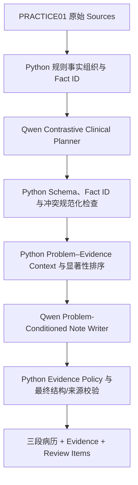
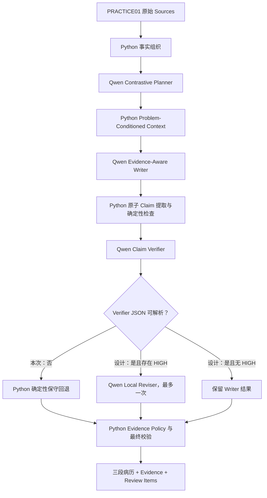

# Mewtype v0.4.3：PRACTICE01 临床病历生成算法对照实验

## 1. 实验概述

本报告分析“循证智录（Mewtype）”v0.4.3 对虚构教学病例 PRACTICE01 的两次独立真实 Qwen 运行。报告只读取既有输入、输出、日志与实现代码，没有重新调用模型。原始病例事实、模型生成文本和本文分析分别标示，本文不构成临床诊疗意见。

| 项目 | C 组 | D 组 |
|---|---|---|
| 项目与版本 | Mewtype v0.4.3 | Mewtype v0.4.3 |
| 测试病例 | PRACTICE01 | PRACTICE01 |
| 输入文件 | `../information/converted/01_input.json` | `../information/converted/01_input.json` |
| 输出文件 | `../clinical_output_c_retest.json` | `../clinical_output_d_retest.json` |
| 运行日志 | `../clinical_run_log_c_retest.json` | `../clinical_run_log_d_retest.json` |
| 模型 | `qwen-plus` | `qwen-plus` |
| 运行模式 | `dev_api`，本地开发验证 | `dev_api`，本地开发验证 |
| 实验时间（北京时间） | 2026-11-24 11:28:14 | 2026-11-24 11:29:19 |
| Prompt Profile | `contrastive`，无 Few-shot | `contrastive`，无 Few-shot |
| 阶段输出格式 | Planner/Writer 均为 `json_schema` | Planner/Writer/Verifier 均为 `json_schema` |
| BGE-M3 | 未使用；`evidence_bundle_count=0`，日志无 retrieval 统计 | 未使用；`evidence_bundle_count=0`，日志无 retrieval 统计 |
| Planner Fallback | 未发生；`planner_fallback=null` | 未发生；`planner_fallback=null` |
| 实际算法模式 | `contrastive` | `contrastive` |
| Verifier | 关闭 | 已调用，但返回不完整 JSON，解析失败 |
| Local Reviser | 关闭 | **Qwen Local Reviser 未调用**；执行了 Python 确定性保守回退 |

需要特别说明：D 组日志中的 `revision_applied=true` 指 `deterministic_conservative_fallback` 修改了一条 `review_items`，不是模型 Local Reviser 成功运行。D 组 Verifier 的 completion 达到配置上限 2048 tokens，响应在字符串中途结束，错误为 `MODEL_INVALID_JSON/INCOMPLETE_JSON`。

## 2. 输入病例：模型究竟看到了什么？

实际输入文件顶层是单元素 JSON 数组，数组中的病例对象结构如下；此处字段和值均来自文件：

```json
[
  {
    "case_id": "PRACTICE01",
    "record_cutoff": "2026-05-03 20:30",
    "sources": [
      {
        "source_id": "P0001",
        "field_path": "入院记录.一般项目.姓名",
        "content": "杨××"
      }
    ]
  }
]
```

病例共有 50 个来源片段。`source_id` 是病例内来源编号，`field_path` 保存原始嵌套字段位置，`content` 保存原文；截止点之后的信息不应进入生成结果。

### 2.1 重要原始事实

| 类别 | 原始病例事实 | source_id | 临床意义（报告分析） |
|---|---|---|---|
| 基本资料 | 女性，35岁；2026-05-03 19:31入院，20:30记录 | P0002、P0003、P0009、P0010 | 确定基本人口学信息与时间边界 |
| 主诉 | 间断咳嗽、咳痰2月，加重伴发热1天 | P0014 | 界定慢性病程与急性加重 |
| 症状演变 | 阵发性咳嗽，夜间及晨起为著；黄白色浓痰、量多、易咳，偶有少量血丝，每周1–2次 | P0015 | 描述呼吸道症状形态及病程 |
| 发热时序 | 入院前1天最高38.5℃，午后及夜间为著；近2月自觉午后低热但未规律测量 | P0015 | 区分实测最高体温与未规律测量的低热感 |
| 伴随症状 | 急性加重伴畏寒、乏力、咽痛、鼻塞；无寒战 | P0015 | 支持急性感染表现并保留明确阴性 |
| 重要阴性 | 无胸痛、胸闷、气促；无消化道、泌尿道症状；无关节肿痛、皮疹、口腔溃疡、光过敏、盗汗及明显消瘦 | P0015 | 为鉴别提供有限的反对或限制信息，不能被扩大解释 |
| 既往治疗 | 曾用头孢、阿莫西林、左氧氟沙星及对症治疗，每次3–5天后部分好转，停药1–2周后反复 | P0015 | 区分既往短疗程反应与当前治疗状态 |
| 当前治疗信息 | 院外自行服用药物，具体不详，病情无好转；未给出入院后当前用药方案 | P0015 | 只能写“具体用药/当前方案未提供”，不能写“未治疗” |
| 禽类暴露 | 家中养鸽约3年，每周清理鸽舍2–3次，未戴口罩 | P0015 | 影响特殊病原体相关鉴别方向 |
| 结核接触限定 | 否认结核患者密切接触史；同楼层邻居2025年因肺结核住院，双方有日常往来 | P0015 | 两种表述必须同时保留，不能简化成“无接触史”或确定“密切接触” |
| 既往史 | 平素健康；否认重要心脑血管、肺、肾、内分泌疾病及传染病；否认哮喘、支气管扩张史 | P0016 | 提供既往病史边界，但不能证明本次不存在相应疾病 |
| 个人史 | 不吸烟、不饮酒；一般毒物/粉尘/放射接触为无，禽类接触另见现病史 | P0017 | 补充暴露与生活史 |
| 入院生命体征 | 体温37.1℃、脉搏80次/分、呼吸20次/分、血压102/68 mmHg | P0021、P0022、P0023、P0024 | 不能把入院前38.5℃误写成入院体温 |
| 更正记录 | 原记录“发绀”经复核为口唇稍干燥、无发绀 | P0035 | 更正后信息优先，防止错误事实传播 |
| 肺部体征 | 双肺呼吸音清，右上肺少量湿啰音；无干啰音、胸膜摩擦音 | P0038 | 支持局部肺部异常并提供明确阴性 |
| 影像 | 右上叶后段及下叶背段斑片状、条索状密度增高影，边界模糊，部分小空洞；纵隔多发稍大淋巴结；双侧无明显胸腔积液 | P0043、P0044 | 支持肺部感染及特殊感染鉴别；CT已在急诊完成 |
| 血常规 | WBC 11.2×10⁹/L、NEUT% 76.5%、HGB 118 g/L、PLT 286×10⁹/L | P0045 | 提供具体数值与单位，不能只保留部分后改变其含义 |
| 炎症指标 | hsCRP 48.6 mg/L | P0046 | 提供炎症相关异常指标 |
| 待完善检查 | 痰涂片及培养、痰抗酸染色、结核感染T细胞检测、G试验、GM试验、血培养、降钙素原、血气分析 | P0047 | 均是“待完善”，不能写成已有结果 |
| 初步诊断 | 肺部感染：社区获得性肺炎，肺结核待排，真菌性肺炎待排（禽类接触史） | P0048 | 只证明原始病历记录了初步/待排方向，不等于确诊 |
| 其他初步诊断 | 急性上呼吸道感染；慢性咳嗽原因待查 | P0049、P0050 | 应与主要肺部问题及不确定性共同理解 |

### 2.2 输出中未充分体现的重要输入

C、D 都突出主要呼吸道症状、影像、炎症指标与暴露史，但均未完整呈现：入院实测体温37.1℃与其他生命体征（P0021–P0024）、无胸腔积液（P0044）、HGB与PLT（P0045）、口唇“发绀”复核更正（P0035）、原始“急性上呼吸道感染”和“慢性咳嗽原因待查”两个诊断条目（P0049、P0050）。这些信息并非都必须进入简洁首程正文，但更正记录、最高体温与入院体温的时序区分尤其值得保留。C 还没有在正文中明确给出入院37.1℃；D 同样遗漏该对照。

## 3. C 组：Contrastive Planner + Evidence-Aware Writer



执行顺序以代码为准：`organize_facts` 先确定性整理事实，`number_facts` 分配 `F001...`；Planner 是第一次 Qwen 调用，输出问题、支持/限制 Fact ID、鉴别方向、缺失资料、计划目标和检索查询。Python 随后检查 Fact ID、Schema 和支持/反对冲突。`build_problem_evidence_context` 将事实正文集中到 `fact_catalog`，问题和鉴别只引用 Fact ID；`evidence_salience_score` 对问题关联、数值、明确阴性、更正、时序、状态及异常发现加权，对无关人口学字段降权。两者是同一次 Writer 调用前的确定性上下文组织，不是额外模型调用。

本次没有配置 Embedding Client，`retrieve_problem_evidence` 返回空列表，因此没有 Dense Retrieval/BGE-M3。Writer 是第二次 Qwen 调用；之后 Python 执行 Evidence 去重、来源合法性、条数限制及最终输出校验。日志显示实际调用2次、事实56条、临床问题3个、Claim 确定性拆分30条，但核验关闭。

“Contrastive Planning（对比式临床规划）”在这里是围绕每个临床问题同时组织支持事实、明确反对或限制事实、鉴别方向和仍待区分的信息，再把它们映射到计划目标；它不是让模型输出隐藏思维链，也不等于诊断已被证实。

### 3.1 病例特点 `case_features`

> 35岁女性，间断咳嗽、咳痰2月，痰中偶带血丝；1天前加重伴发热（最高38.5℃）、畏寒、乏力、咽痛、鼻塞；胸部CT示右肺上叶后段及下叶背段斑片状、条索状影伴小空洞及纵隔多发稍大淋巴结；血WBC 11.2×10⁹/L、NEUT% 76.5%、hsCRP 48.6mg/L；有鸽子接触史（每周清理鸽舍2–3次，未戴口罩）；否认结核密切接触史，但同楼层邻居2025年曾患肺结核；既往无基础肺病、免疫病或结构性肺病证据；体查仅右上肺少量湿啰音，余无明显阳性体征。

### 3.2 拟诊讨论 `diagnostic_discussion`

> 当前以慢性咳嗽伴新发发热、肺部空洞影及纵隔淋巴结肿大为核心表现，需重点鉴别肺结核、侵袭性肺真菌病（如隐球菌、曲霉）及社区获得性细菌性肺炎。肺结核支持点：空洞影、纵隔淋巴结、午后低热感、邻居住户结核病史；但痰抗酸染色、结核感染T细胞检测、痰培养结果均未提供，无法确诊或排除。真菌性肺炎支持点：鸽类长期接触史、空洞与淋巴结表现；G试验、GM试验、痰真菌培养尚未回报。细菌性肺炎可能，WBC及CRP升高、急性起病，但缺乏典型高热、寒战及肺实变体征，且既往多次抗生素治疗部分有效但易复发，不完全符合普通CAP。非感染性病因（如自身免疫病）可能性较低，因无皮疹、关节痛、口腔溃疡、光过敏、盗汗等系统表现，且皮肤、淋巴结、关节、神经系统查体均阴性，但ANA等免疫指标尚未检查，不能完全排除。

### 3.3 诊疗计划 `plan`

> 已完善胸部CT及血常规、hsCRP；待查痰涂片及培养、痰抗酸染色、结核感染T细胞检测、G试验、GM试验、血培养、降钙素原、血气分析；可考虑结合病情完善ANA、ENA、ANCA等免疫指标及高分辨率CT，具体由医生判断；动态观察抗感染治疗反应。当前用药情况未提供。

### 3.4 Evidence

| statement | kind | source_ids |
|---|---|---|
| 患者主诉间断咳嗽、咳痰2月，加重伴发热1天。 | fact | P0014 |
| 胸部CT示右肺上叶后段及下叶背段斑片状、条索状密度增高影，边界模糊，部分病灶内见小空洞影，纵隔内见多发稍大淋巴结。 | fact | P0044 |
| 家中饲养鸽子约3年，每周清理鸽舍2‑3次，清理时未佩戴口罩。 | fact | P0015 |
| 血常规示WBC 11.2×10⁹/L，NEUT% 76.5%；hsCRP 48.6mg/L。 | fact | P0045、P0046 |
| 慢性呼吸道症状反复发作、抗感染疗效短暂、影像学空洞与纵隔淋巴结共存，提示特殊病原体感染可能，需进一步病原学排查。 | inference | P0015、P0044 |

### 3.5 Review Items

1. 痰抗酸染色、结核感染T细胞检测、痰培养结果未知
2. G试验、GM试验、血培养结果未知
3. 降钙素原、血气分析结果未知
4. 免疫相关指标（如ANA、ENA、ANCA）尚未检查
5. 当前抗感染治疗方案及用药情况未提供

## 4. D 组：Contrastive Generation + Evidence Verification



设计上，Writer 草稿被拆成逐条 Claim；Python 规则检查未知写成否定、否定范围、时序、计划/完成状态、诊断确定程度和更正关系，Qwen Verifier 再为全部 Claim 返回 verdict 与风险问题。只有成功解析的 HIGH 问题才会进入 Qwen Local Reviser；MEDIUM 进入待核事项，LOW 不触发修订。

本次实际执行 Planner、Writer、Verifier 共3次 Qwen 调用。Verifier 返回内容在第3634字符处形成未闭合字符串，解析失败；程序没有调用 Qwen Reviser，而是重新执行确定性检查，定位1条高风险“未知状态写成否定”问题，对 `review_items` 做一次保守替换并增加披露信息。日志状态为 `incomplete_with_conservative_fallback`，不是“Verifier核验通过”。

### 4.1 病例特点 `case_features`

> 35岁女性，间断咳嗽、咳痰2月，夜间及晨起加重，黄白色浓痰，偶带血丝；近1天加重伴发热（最高38.5℃）、畏寒、乏力、咽痛、鼻塞。有鸽子接触史3年，未戴口罩；同楼层邻居2025年患肺结核并有日常往来。胸部CT示右肺上叶后段及下叶背段斑片状、条索状影伴小空洞，纵隔多发稍大淋巴结；血WBC 11.2×10⁹/L，NEUT% 76.5%，hsCRP 48.6mg/L；体查仅右上肺闻及少量湿啰音，余无明显阳性体征。

### 4.2 拟诊讨论 `diagnostic_discussion`

> 当前以慢性咳嗽伴急性加重、空洞性肺病及纵隔淋巴结肿大为核心表现，高度提示特殊病原体感染。肺结核支持点：空洞影、纵隔淋巴结、午后低热感、邻居住户结核接触史；但痰抗酸染色、T细胞检测及培养结果未知，且否认密切接触史，需进一步排除。真菌性肺炎（如隐球菌、曲霉）亦高度可疑：长期禽类暴露为重要危险因素，空洞与淋巴结肿大符合部分真菌感染影像特征；G/GM试验、痰真菌培养及血清学检查尚未回报。细菌性肺炎可能性存在，但缺乏典型急性起病、高热、全身中毒症状，且既往多次广谱抗生素治疗部分有效但易复发，不支持单纯常见细菌感染。非感染性肉芽肿病（如结节病、血管炎）依据薄弱：无皮疹、关节肿痛、光过敏、盗汗、消瘦等系统表现，皮肤黏膜、淋巴结、神经系统查体均阴性，暂不支持。

### 4.3 诊疗计划 `plan`

> 已计划完善痰涂片及培养、痰抗酸染色、结核感染T细胞检测、G试验、GM试验、血培养、降钙素原及血气分析；建议结合病情尽快行支气管镜检查或高分辨率CT（HRCT）以明确空洞性质及基础气道结构；当前用药情况未提供，需确认是否已启动经验性抗感染治疗；慢性咳嗽病因需待排除哮喘、支气管扩张等结构性/功能性病变。

### 4.4 Evidence

| statement | kind | source_ids |
|---|---|---|
| 患者主诉间断咳嗽、咳痰2月，加重伴发热1天。 | fact | P0014 |
| 家中饲养鸽子约3年，每周清理鸽舍2‑3次，清理时未佩戴口罩；同楼层邻居曾于2025年因肺结核住院治疗，患者与其有日常往来。 | fact | P0015 |
| 胸部CT示右肺上叶后段及下叶背段斑片状、条索状密度增高影，边界模糊，部分病灶内见小空洞影，纵隔内见多发稍大淋巴结。 | fact | P0044 |
| 血常规WBC 11.2×10⁹/L，中性粒细胞比例76.5%；hsCRP 48.6mg/L，提示明显炎症反应。 | fact | P0045、P0046 |
| 初步诊断包含肺结核待排、真菌性肺炎待排，反映临床对特殊病原体的高度警惕。 | inference | P0048 |

### 4.5 Review Items

1. 痰抗酸染色、分枝杆菌培养及结核感染T细胞检测结果未知
2. G试验、GM试验、痰真菌培养及血清曲霉抗体结果未知
3. 相关检查或治疗状态未提供，需医生确认。
4. 当前是否已开始经验性抗感染治疗需确认
5. 血气分析、肺功能及支气管激发/舒张试验未提供
6. 相关事实已作保守处理，仍需医生确认：原始资料未提供该检查或治疗的执行状态，不得写成未执行、未进行或未用药。
7. 自动核验未完成，病历内容需由医生结合原始资料复核。

## 5. Input vs C vs D：事实忠实性比较

下表的“判断”由报告作者依据输入逐项核对，不代表专业医学结论。“合理归纳”表示存在患者事实依据且保留不确定性；“待核”表示现有资料不足或表述边界需要人工确认。

| 原始输入事实 | source_id | C 组表达 | D 组表达 | 判断 |
|---|---|---|---|---|
| 35岁、女性 | P0002、P0003 | “35岁女性” | “35岁女性” | **忠实** |
| 咳嗽、咳痰2月，1天急性加重伴发热 | P0014、P0015 | 准确保留慢性病程和急性加重 | 准确保留，且补充夜间/晨起、痰性状 | **忠实** |
| 入院前最高38.5℃；入院体温37.1℃ | P0015、P0021 | 写“最高38.5℃”，未写入院37.1℃，但未误称入院体温 | 同C | 最高体温**忠实**；入院测量**遗漏** |
| CT在急诊完成：右肺斑片/条索影、小空洞、纵隔淋巴结；无明显胸腔积液 | P0043、P0044 | 主要异常准确；计划中写“已完善CT”；未提无积液 | 主要异常准确；未提无积液 | 主要影像**忠实**；无积液**遗漏** |
| WBC 11.2×10⁹/L、NEUT% 76.5%、hsCRP 48.6 mg/L | P0045、P0046 | 数值、单位准确 | 数值、单位准确 | **忠实** |
| HGB 118 g/L、PLT 286×10⁹/L | P0045 | 未体现 | 未体现 | **遗漏**，但是否必须进入简洁正文需结合写作目标 |
| 养鸽3年，每周清理2–3次且不戴口罩 | P0015 | 完整保留 | 病例特点保留年限和不戴口罩，Evidence完整保留频次 | **忠实** |
| 否认结核密切接触；邻居患结核且有日常往来 | P0015 | 两种限定均保留 | 病例特点只写邻居往来，讨论中补充否认密接 | C、D整体均**忠实**；D单看病例特点不完整 |
| 无胸痛、胸闷、气促；无寒战；无多项系统症状 | P0015 | 提及无寒战及部分系统阴性，其他多未写 | 提及多项系统阴性，但未系统保留呼吸道阴性 | 部分**忠实**、部分**遗漏**；简洁生成不要求穷举 |
| 既往三类抗生素短疗程后部分好转、停药后复发 | P0015 | “多次抗生素治疗部分有效但易复发” | “多次广谱抗生素治疗部分有效但易复发” | C为**合理归纳**；D的“广谱”是概括性措辞，宜**待核** |
| 院外服药具体不详；入院后当前用药方案未提供 | P0015 | 明确“当前用药情况未提供” | 明确“当前用药情况未提供，需确认是否已启动” | **忠实/待核**，均未写成“尚未治疗” |
| 原“发绀”复核为无发绀 | P0035 | 未体现 | 未体现 | **遗漏**；本例存在明确更正，建议纳入安全核对 |
| 痰涂片培养等八类检查“入院后待完善” | P0047 | 用“待查”表达，未写成已有结果 | 用“已计划完善”表达，未写成已有结果 | **忠实** |
| 痰真菌培养、血清曲霉抗体、ANA/ENA/ANCA、肺功能等未在原文明确列为已查或未查 | P0015、P0047（边界依据） | 写“痰真菌培养尚未回报”“ANA等尚未检查” | 写“痰真菌培养及血清学尚未回报”“肺功能等未提供” | “未提供”可接受；“尚未检查/尚未回报”可能把未知状态具体化，属于**待核**，C的“尚未检查”更接近**不忠实** |
| 初步诊断为CAP、肺结核待排、真菌性肺炎待排 | P0048 | 以“需重点鉴别/无法确诊或排除”表达 | 以“高度提示/高度可疑”开头，但仍写“需排除/结果未知” | C为**合理归纳**；D保留待排但确定语气偏强，属**待核** |
| 明确存在1天急性加重、发热、畏寒、乏力 | P0014、P0015 | 讨论承认“急性起病”，同时说缺乏典型高热/寒战 | 先写“慢性咳嗽伴急性加重”，后又说“缺乏典型急性起病、高热、全身中毒症状” | C基本**合理归纳**；D“缺乏典型急性起病”与明确急性加重存在冲突，属**不忠实/需修正** |
| 既往否认哮喘、支气管扩张史，不等于本次已排除 | P0016 | 概括成“无基础肺病、免疫病或结构性肺病证据” | 计划提出仍需排除哮喘、支扩 | C对“免疫病”及结构病的概括依据不足，属**待核**；D保留了本次仍需评估的不确定性 |

此外，D 的一条 Evidence 把“WBC/NEUT/hsCRP数值”与“提示明显炎症反应”整体标为 `fact`；前半是原始事实，后半属于解释性推断，`kind` 边界不够精确。C 的对应 Evidence 仅陈述数值，类型更清楚。

## 6. C vs D：两种算法路线的比较

C 是 **Planning-Augmented + Evidence-Grounded Generation（规划增强、证据约束生成）**：重点在生成前把患者事实组织为临床问题、支持/限制信息、鉴别方向和计划目标。D 是 **Planning-Augmented Generation + Post-Generation Claim Verification（规划增强生成加生成后逐陈述核验）**：在 C 的设计上增加 Claim 拆分、确定性规则、Qwen Verifier 和条件式局部修订。

| 对比项 | C | D |
|---|---|---|
| Planner | 有 | 有 |
| Evidence-Aware Writer | 有 | 有 |
| Claim Extraction | 生成后进行了确定性拆分，但无独立核验流程 | 有，拆分28条 Claim 并进入核验流程 |
| Qwen Verifier | 无 | 有，但响应截断、JSON解析失败 |
| Local Reviser | 无 | 设计上条件触发；本次Qwen Reviser未调用，改用Python保守回退 |
| Dense Retrieval/BGE-M3 | 无 | 无 |
| 实际调用次数 | 2 | 3 |
| Prompt Tokens | 25,145 | 33,743 |
| Completion Tokens | 2,244 | 4,461 |
| 总 Token | 27,389 | 38,204 |
| 总耗时（病例） | 51,705.41 ms | 101,446.11 ms |
| 正文字符数 | 696 | 681 |
| Evidence 条数 | 5 | 5 |
| Review Items 数量 | 5 | 7 |
| Planner Fallback | 无 | 无 |
| 最终核验状态 | `not_run` | `incomplete_with_conservative_fallback` |

D 比 C 多10,815个 Token，病例耗时增加49,740.70 ms；增加的第三次调用没有形成可解析的 Verifier 结果。D 最终比 Writer 草稿多出的明确可归因变化只发生在 `review_items`：确定性保守回退将一条未知状态风险改成通用“状态未提供”，并追加风险披露；随后又追加“自动核验未完成”。

C、D 是两次独立 Qwen 运行，各自的 Planner 和 Writer 输出都可能有生成差异。即使温度为0、种子相同，远程服务也不承诺逐字确定，因此病例特点、拟诊讨论、计划和 Evidence 的其他差异不能归因于 Verifier。只有日志明确记录的保守回退变化可以归因于 D 的核验后处理。

## 7. 算法优点、问题与局限

### 7.1 观察到的优点

1. **问题导向较明显。** 两组拟诊讨论都围绕慢性咳嗽急性加重、空洞影、纵隔淋巴结、禽类暴露和邻居结核史组织肺结核、真菌感染与细菌性肺炎，而不是简单复述全部入院字段。
2. **患者特异证据得到利用。** 鸽舍暴露频次、抗感染后反复、空洞和淋巴结、具体炎症数值都进入生成；两组没有机械抄写姓名、民族、婚姻、住址等低相关人口学信息。
3. **主要数值、否定和计划状态大体保持。** WBC、NEUT%、hsCRP与最高体温没有改变；结核密接否认与邻居往来没有被简化为相反事实；P0047的检查保持“待查/已计划”，没有伪造结果；当前用药保持“未提供”。
4. **引用编号合法。** 两组最终 Evidence 的所有 source_id 均存在于PRACTICE01输入，Evidence Policy未移除非法项。

### 7.2 观察到的问题

1. **对比式讨论仍会生成过强或不精确的反对依据。** D 同时承认“急性加重”又声称“缺乏典型急性起病”，语义冲突；两组都把部分“未在原文记录”的检查扩写成“尚未检查/尚未回报”。
2. **重要安全事实可能因压缩遗漏。** 入院37.1℃、发绀更正、无胸腔积液未进入正文。显著性排序给更正加权，但最终是否写入仍由 Writer 决定，不能保证召回。
3. **计划包含模型新增建议。** C新增免疫指标和HRCT，D新增支气管镜、HRCT、肺功能等。这些以“可考虑/建议/需排除”呈现，没有伪装成已执行，但其个体化合理性仍需医生审核。
4. **Evidence 类型边界仍可能漂移。** D 将“提示明显炎症反应”的推断包在 `fact` 中；程序只校验 `fact/inference` 枚举和来源合法性，不能完全判断语义类型是否恰当。

### 7.3 D 组核验的实际效果与成本

D 的 Qwen Verifier 没有产生可用 verdict，不能据此声称模型核验改善了医学质量。Python 确定性规则确实识别并保守处理了一条“未知状态写成否定”风险，使最终输出增加了明确披露；但它没有纠正 D 讨论中“缺乏典型急性起病”等语义问题。相比 C，D 增加约39.5%的总 Token，耗时接近翻倍，并产生2条额外 Review Item。本例显示非阻断式降级避免了整例失败，但也显示 Verifier 输出长度与 `max_tokens=2048` 是现实瓶颈。

### 7.4 实现依赖与边界

- Prompt 决定 Planner 如何区分支持、限制、缺失信息，以及 Writer 如何保持计划/完成状态；模型仍可能违反这些语义要求。
- JSON Schema 保证字段和枚举形状，Python 校验保证 Fact/source ID、条数和部分数值/否定/时序规则；它们不能代替医学判断。
- 规则事实抽取、显著性词表和 Claim 分句均是启发式方法，可能漏掉复合事实、否定作用域和跨句时序。
- Dense Retrieval 是可选实现；本次完全未启用，不能把结果归因于BGE-M3。
- 单个虚构病例、两次独立生成且没有医学专家金标准，无法证明算法在其他病例上的总体优越性。

## 8. 结论

本次实验验证了 v0.4.3 能在 PRACTICE01 上完成规则事实组织、对比式问题规划、证据感知写作、合法来源输出与非阻断式核验降级。C 以2次调用生成了较紧凑且问题导向明确的病历；D 增加逐Claim核验，但Verifier响应截断，实际只由Python保守处理一条未知状态风险，3次调用带来更高Token和约两倍耗时。两组主要数值、暴露史、结核接触限定及待查状态总体忠实，但仍有更正记录遗漏、未知被具体化以及D组急性起病表述冲突。就本例而言，C成本更低且文本针对性不逊于D；现有证据不足以证明任一路线整体更优，仍需固定病例集和独立医学审核。
